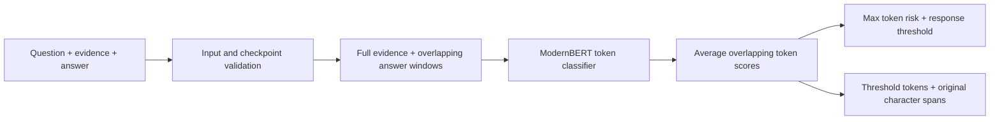

# GroundCheck

**Evidence-grounded hallucination detection with token-level localization and reproducible ML research.**

GroundCheck checks whether a generated answer is supported by supplied evidence.
It returns a response-level risk score and candidate error spans in the original
answer. It is a detector and evaluation toolkit, not a retrieval system or generator.

The main neural baseline, **B7**, fine-tunes ModernBERT with an answer-token head
on RAGTruth annotations. The project also contains lexical and third-party verifier
baselines, grouped evaluation, and documented negative experiments.

**Evidence status:** B7's approximately **0.796 macro-F1** comes from **reused
RAGTruth inner-validation**, not an independent test. Synthetic improvements did
not establish natural generalization. Exact error-span localization remains weak.
There is no demonstrated new architecture, SOTA result, or associated publication.

## Architecture overview



Evidence is never silently truncated. The B7 contract uses at most 2,048 tokens per
window and up to 512 answer tokens, with overlap. If the evidence leaves insufficient
answer capacity, inference fails explicitly. Scores are **not calibrated
probabilities**. A positive response can have no returned span because response and
token thresholds differ.

## Quick start

Python **3.11 or 3.12**; run research entrypoints from the checkout root (canonical implementations live in `experiments/scripts/`).

```bash
git clone https://github.com/Mahan1341/GroundCheck.git
cd GroundCheck
python -m venv .venv
# Linux/macOS: source .venv/bin/activate
# Windows PowerShell: .venv\Scripts\Activate.ps1
python -m pip install -e '.[dev]'
python -m pytest -q
python -m ruff check .
python -m pip check
```

The base install and offline tests require **no GPU, dataset or model download**.
A fully offline pipeline demonstration uses authored fixtures, not fake neural output:

```bash
ghl baseline --data-dir tests/fixtures --config configs/baseline.toml --output reports/toy-majority.json
```

### Neural inference

**Weights are not bundled or hosted by this release.** Obtain a permitted B7 artifact
or reproduce the documented training recipe before neural inference. See
[checkpoint provenance and reproduction](docs/CHECKPOINT.md). A clean clone alone
cannot run B7 without those weights; a base ModernBERT checkpoint is not a trained detector.

```bash
# CPU wheel first; use the PyTorch CUDA index instead for a CUDA installation.
python -m pip install torch==2.8.0 --index-url https://download.pytorch.org/whl/cpu
python -m pip install -e '.[neural]'
groundcheck --checkpoint models/b7 --device cpu --input examples/input.json
groundcheck --checkpoint models/b7 --device cuda --format jsonl --input examples/input.jsonl --output predictions/demo.jsonl
```

`--device auto` is available. Inference is FP32, batch size one, TF32 disabled;
JSONL runs examples sequentially. Checkpoint files are verified against the bundled
SHA256 profile before loading. Missing or mismatched weights produce an error, never
random-weight inference. Loading is local-only with custom remote code disabled.
The original `ghl` dataset/evaluation CLI remains available.

## Example inference

[examples/input.json](examples/input.json) is an original fictional example:

```json
{
  "question": "How many sensors does the fictional Aster station have?",
  "evidence": "The fictional Aster station has twelve sensors. The fictional Birch station has twenty sensors.",
  "answer": "The Aster station has twenty sensors."
}
```

The output contains `hallucination_risk`, `prediction`, `spans`, `model`, `coverage`
and `warnings`. Each span contains `start`, `end`, `text` and `score`, with
`answer[start:end] == text`; offsets are zero-based, end-exclusive Python Unicode
character indices, not byte offsets. `--include-tokens` adds original token offsets
and scores. Empty answers return `status: "no_answer"`; that is not verified support.
Empty evidence is explicitly flagged. Untrusted input remains data, not executable instructions.

[Recorded demo output](examples/output.cpu.json) is a real run of the documented B7
checkpoint on that authored input. It is a reproducibility example, not a quality
benchmark or proof that numerical relations are solved. CPU/CUDA scores may differ
slightly; hardware, precision and thresholds are recorded.
In this example B7 flags the wrong answer but also highlights the extraneous word
"The" alongside "has twenty": the saved output deliberately exposes imperfect localization.

## Models and baselines

| Component | Role | Status |
|---|---|---|
| Majority / TF-IDF | Dataset and evaluation sanity baselines | Offline library and CLI |
| B7 / ModernBERT-base + token head | Own supervised baseline; 149M-parameter backbone | Main inference adapter; explicit external checkpoint |
| Generic NLI / MiniCheck / HHEM | Verifier controls | Experimental, separate model licenses and provenance |
| FactCG | Published third-party factual verifier | Research comparator, not our invention |
| Graph, normalization, permutation, saliency, context subtraction | Mechanism tests | Experimental; negative results retained |

Stable inference lives in `src/grounded_hallucination_lab/inference.py`. Experimental
components live in `src/grounded_hallucination_lab/research/`; research plans, reports
and executable scripts are organized under `experiments/`. Historical `scripts/`
entrypoints remain as compatibility shims for old commands.
There is no automatic transition from a diagnostic win to a production model.

## Evaluation protocol

The positive class means **annotated hallucination relative to supplied evidence**.
Original partitions are grouped by `source_id`; all answers for one source stay
together. Train-side architecture development is distinct from outer calibration,
dev and official test. The official test remains closed; this release runs no new
outer evaluation or training. Repeatedly studied inner data are development evidence.

Report response macro-F1 separately from hallucination-class F1, AUROC and Average
Precision. AP is not trapezoidal PR-AUC. Localization uses custom token, non-whitespace
character and exact merged-span metrics, not an asserted official RAGTruth scorer.
Paired source bootstrap preserves grouped dependence but does not undo model-selection
bias. See [evaluation protocol](docs/EVALUATION_PROTOCOL.md).

## Reproducible results

Do not compare the following as one leaderboard: they use different tasks and populations.

* **RAGTruth QA outer dev, historical Phase 2A:** 1,008 responses / 168 sources.
  TF-IDF macro-F1 **0.5909**, hallucination F1 **0.5000**; majority macro-F1 **0.4102**.
  The threshold was selected on calibration before dev. [Report](experiments/reports/PHASE2A_RESULTS.md).
* **RAGTruth QA reused inner:** historical B7 macro-F1 about **0.7959** on 648
  responses / 108 sources. Later development subsets and FP32 runs have different
  denominators; they are not new independent confirmation. [B7 reproduction](docs/CHECKPOINT.md).
* **RefChecker/Dolly confirmation:** 363 responses / 54 sources, response labels
  derived from human labels on extracted triplets. FactCG segmented macro-F1
  **0.7037**, B7 **0.6338**. No human span labels; triplet completeness limits the
  interpretation. This collection is now used and closed to new decisions.
  [Discovery report](experiments/reports/RESEARCH_LOOP_VERDICT.md).
* **DiaSumFact SAMSum transfer:** dialogue summarization, 295 summaries / 59 sources;
  284 summaries have uniquely alignable error strings for localization. FactCG
  segmented macro-F1/token-F1 **0.7255/0.2856**, B7 **0.5067/0.1610**. Author-released
  human annotations, not assistant review; exact-span localization remains weak.
  Different error taxonomy and incomplete contamination audit. This set is now used.
  [Claim-grounding report](experiments/reports/CLAIM_GROUNDING_RESEARCH.md).

Full historical model/data caches and predictions are intentionally not distributed.
The source, configs and reports permit inspection and new reproduction runs; they do
not imply that every historical byte-level artifact is recoverable from Git alone.

## Research history and ablations

The [research timeline](docs/RESEARCH_TIMELINE.md) links the main reports, including
failed gates. Numeric normalization and relation renderers helped narrow synthetic
tests, without demonstrated natural gains. Graph extraction did not achieve useful
natural structural coverage. Permutation augmentation failed its preregistered gate.
Gradient attribution lost error-token recall; context subtraction damaged claim
ranking. No frozen-representation probe was trained before this engineering release.

## Known limitations

* A score is evidence-relative risk, not verified world truth or calibrated confidence.
* Max-token aggregation is sensitive to answer length; exact error boundaries are weak.
* Correct paraphrases, entity–value binding, negation and short errors remain difficult.
* Checkworthiness and mixed refusals are not solved; low similarity is not proof of error.
* Reused development results and synthetic gains do not establish deployment safety.
* Public pretrained weights may have unknown overlap; available-text audits are incomplete.
* No independent official-test result, guaranteed cross-domain threshold, or SOTA claim.
* Full benchmark reproduction requires separately obtained datasets and compute.

## Reproducibility, citation and licensing

Own code and newly authored fixtures/examples: **MIT**. Dependencies, datasets and
model weights retain their own terms; MIT here does not relicense them. See
[NOTICE](NOTICE.md), [checkpoint recipe](docs/CHECKPOINT.md), and
[publication audit](docs/PUBLICATION.md). No dataset dumps, checkpoints, secrets,
private review packs or machine-specific configuration are included.

Use the repository URL and commit SHA to cite a software version; `CITATION.cff`
provides software attribution. Cite RAGTruth, ModernBERT and the relevant third-party
verifier papers separately. This repository is an engineering/research portfolio,
not a claim of a peer-reviewed contribution.
